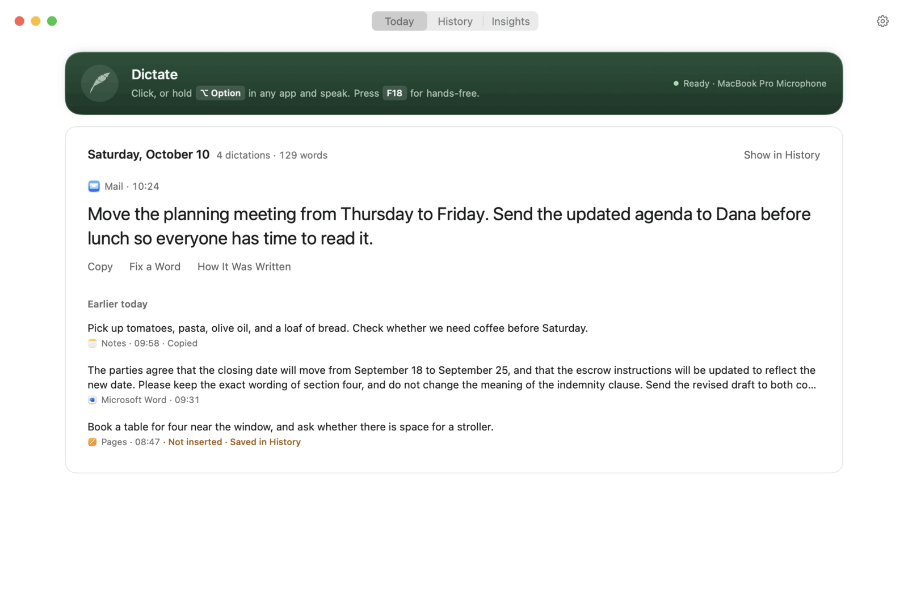
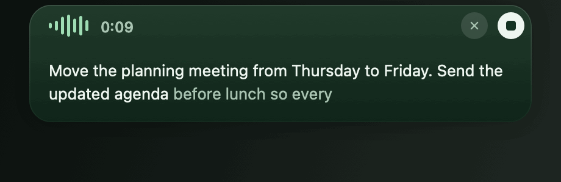
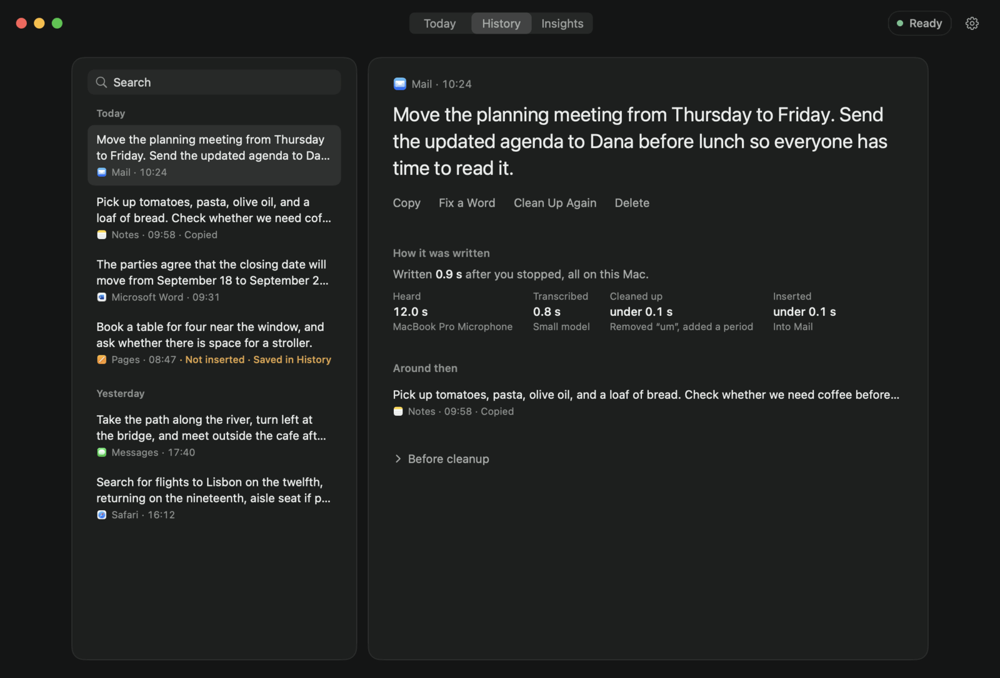
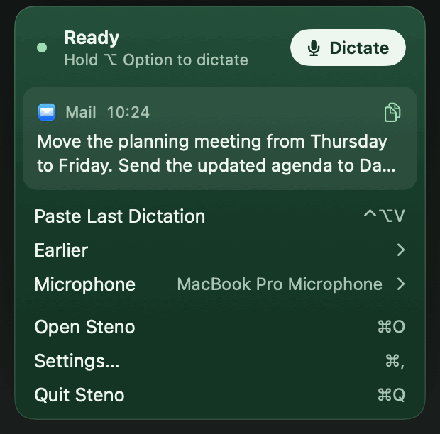
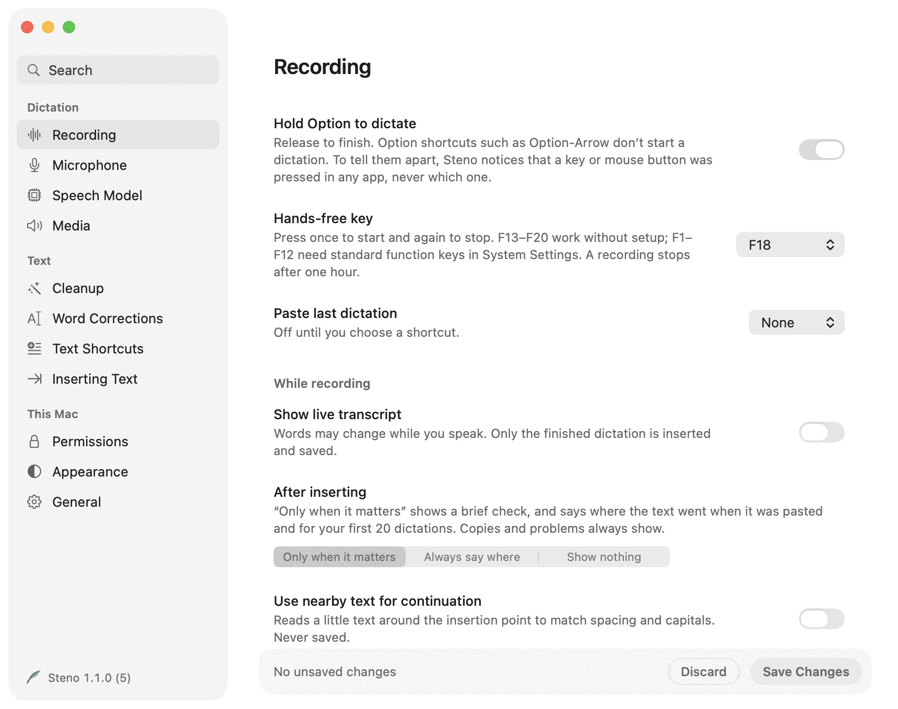

# Steno

Steno is a free, open-source dictation app for people who would rather speak than type on an Apple silicon Mac.

[Download](https://github.com/Ankit-Cherian/steno/releases/latest) · [Build from source](QUICKSTART.md) · [Changelog](CHANGELOG.md)

<picture>
  <source media="(prefers-color-scheme: dark)" srcset="assets/1.1/today-dark.png">
  
</picture>

Hold **Option**, speak, and release to type into the app you're using. Speech recognition runs on your Mac through [whisper.cpp](https://github.com/ggerganov/whisper.cpp), with no account or API key required. This guide describes **Steno 1.1**. Screenshots use fictional sample data.

## Install

Steno requires **macOS 13 or later and Apple silicon**.

The download is about 440 MB, and the installed app takes about 490 MB. Most of that is the bundled small.en speech model, so you don't need to set up a separate transcription service. The model loads into memory on your first dictation.

1. Download `Steno-1.1.0.dmg` from the [latest release](https://github.com/Ankit-Cherian/steno/releases/latest).
2. Open the DMG and drag Steno into Applications.
3. Launch Steno from Applications.

To update, download the latest release and replace the copy in Applications.

The GitHub Releases page is the only place Steno is published, so don't install a copy from anywhere else.

### Verify the download

Each release lists the DMG's SHA-256 hash in its `SHA256SUMS` file, and GitHub shows the hash on each asset. To check your copy, run this command in the folder that holds the DMG and compare the result:

```sh
shasum -a 256 Steno-1.1.0.dmg
```

To confirm that this repository's release workflow built the DMG, run this command with the [GitHub CLI](https://cli.github.com):

```sh
gh attestation verify Steno-1.1.0.dmg -R Ankit-Cherian/steno
```

## Permissions

The setup guide asks for three permissions one at a time. Changes you make in System Settings take effect when you switch back to Steno. The guide ends with a first dictation in a practice box.

| Permission | Why Steno asks | What works without it | Where to revoke it |
| --- | --- | --- | --- |
| Microphone | To record you while you dictate. | Steno can't record. History, Insights and Settings still work. | System Settings › Privacy & Security › Microphone |
| Accessibility | To insert your words where you're typing. | Steno copies each dictation instead of inserting it. Press **Cmd+V** to paste it. | System Settings › Privacy & Security › Accessibility |
| Input Monitoring | To use Steno's shortcuts while another app is in front. | Steno can't detect Hold Option, the hands-free key or the Paste Last Dictation shortcut in other apps. The Dictate area on Today and Dictate in the menu bar panel still work. | System Settings › Privacy & Security › Input Monitoring |

While **Hold Option to dictate** is on, Steno notices every key press and mouse click in any app. To tell a shortcut such as Option+Arrow from a dictation, it uses only the fact that a key or button was pressed. The hands-free key and the Paste Last Dictation shortcut are matched by key code. While the menu bar panel is open, Steno reads which key you press in another app so the panel can close. Steno reads no typed text.

## Privacy

- Transcription runs on your Mac.
- The only network use is downloading an optional model from Settings › Speech Model. Each download is checked against its known size and SHA-256 hash before it's installed.
- Steno has no account, telemetry or crash reporting.
- History (your most recent 1,000 dictations), Insights (session dates, app identifiers and usage counts) and your settings are stored in `~/Library/Application Support/Steno/`. Downloaded models are stored there too.
- **Delete All History…** removes the entries and the backup copies Steno keeps of the History file.
- A dictation into a password field is copied, never inserted, and is marked private on the clipboard.

### Uninstall

1. Quit Steno.
2. Move Steno from Applications to the Trash.
3. Delete the folder `~/Library/Application Support/Steno/`. This removes History, Insights, your settings and any downloaded models.
4. In System Settings › Privacy & Security, remove Steno from Microphone, Accessibility and Input Monitoring.

## Dictate

Click into a text field in any app, hold Option, and say a sentence. Recording starts the moment Option goes down. The island appears at the top of the screen once Steno can tell you're holding Option rather than typing a shortcut. It grows out of the notch when the only display is a built-in one with a notch, and is a small capsule otherwise. Release Option when you're finished. Steno transcribes the recording and inserts the result.



Steno copies the text instead of inserting it in two cases. One is when the text cursor is in a password or other secure field. The other is when focus moved to a different field or app while Steno was transcribing. The island then says "Copied" with the reason, such as Password field or App changed. Press **Cmd+V** where you want the text. You can also copy it again from Today or History.

In Terminal and other apps where Steno pastes, it puts your previous clipboard contents back shortly after pasting. It doesn't restore a password or other item marked private. In remote-desktop apps the transcript stays on the clipboard, because they may read it only when the remote side pastes. When Steno only copies the text, the text stays on the clipboard.

For longer recordings, choose a hands-free key in Settings › Recording. The default is **F18**. Press it once to start and again to finish. Choose **Disabled** to turn the key off. Hold Option and the Dictate area keep working.

Stop finishes a recording, while the island's × discards it, including while Steno is transcribing. If you discard a recording that ran for more than 30 seconds, Undo brings it back for 5 seconds. Recordings stop after one hour and are transcribed, with a countdown in the island during the last minute.

Turn on **Show live transcript** to see the words in the island as you speak. Those words may change as recognition continues. The completed recording determines the text that gets inserted and saved.

## The main window

The toolbar switches between **Today**, **History** and **Insights** (Cmd+1 to Cmd+3), and shows a status label when something needs attention. Click the label to open the Settings page that fixes it.

**Today** starts with the Dictate area. Click it to dictate into the window, and the words are copied when you stop. It also names the shortcuts that work and the microphone in use. Below it are today's latest dictation, with **Copy**, **Fix a Word** and **How It Was Written**, and up to 12 earlier dictations from today.



**History** keeps your most recent 1,000 dictations on your Mac. Search them, or use the menu in the search field to show only those that were inserted, copied or not inserted. A dictation shows where its text went. It offers **Copy**, **Fix a Word**, **Clean Up Again** and **Delete**. Clean Up Again runs cleanup with your current settings, and **Restore Original Cleanup** undoes it.

**How it was written** shows how long the text took after you stopped, and each step: the microphone, the model, what cleanup changed, and where the text went. **Delete All History…** is in the search field's menu and in Settings › General. Deleting also removes the text from the backup copies Steno keeps of the History file.

**Fix a Word** corrects a misheard word in a saved dictation. Click the word, or choose **Choose from a List…**, then type the correct spelling. Choose **Just this dictation**, or **This and future dictations** to also add the correction to Word Corrections. Only Steno's copy changes. The app the text went into keeps the original. Cmd+E starts Fix a Word and Cmd+I opens How it was written for the dictation on screen.

**Insights** opens with a sentence on this month's words and the typing time they saved, counted against typing at 40 words a minute. Below it are a calendar of the last six months with your busiest day, and the apps your words went to. Insights stores session dates, app identifiers and usage counts without a second copy of your transcripts or audio. Deleting History entries leaves those totals intact. [View Insights](assets/1.1/insights-light.png).

## The menu bar

The quill in the menu bar shows Steno's state and your voice level while you dictate. Click it for a panel with Dictate or Stop, your latest dictation with a button to copy it, **Paste Last Dictation**, earlier dictations, and the microphone.



**Paste Last Dictation** inserts your latest dictation into the app in front again. To use it from any app, choose a shortcut for it in Settings › Recording: Control-Option-V or Control-Option-Command-V. No shortcut is set by default.

## Settings

Settings opens in its own window (Cmd+,), with these pages:

- **Dictation:** Recording, Microphone, Speech Model and Media. The Recording page covers Hold Option, the hands-free key, the Paste Last Dictation shortcut, the live transcript, what the island shows after inserting, and nearby-text continuation.
- **Text:** Cleanup, Word Corrections, Text Shortcuts and Inserting Text.
- **This Mac:** Permissions, Appearance and General.



Changes wait in a bar at the bottom of the window until you choose **Save Changes**. **Discard** restores the saved values. Appearance changes save immediately.

- **Microphone:** Steno follows the system input unless you choose another. If the chosen microphone isn't connected, Steno uses the system input until it's back. **Test Microphone** shows your level for up to 5 seconds.
- **Word Corrections:** add misheard words and preferred spellings, for every app or for one app. Corrections apply to every dictation, however clearly it was spoken. That includes corrections that only change capitalization, such as "github" to "GitHub". Steno always keeps a few common words as spoken, such as "cloud" and "code". Settings shows a correction for one of them as Never applies.
- **Text Shortcuts:** expand a short phrase into saved text, such as an address or a reply you use often.
- **Cleanup:** choose a layout (As spoken, Paragraphs or Bullets) and how many filler words to remove (Light, Balanced or Thorough), everywhere or for one app. Light and Balanced remove no filler words. Thorough removes "um", "uh", "I mean", "basically", "sort of" and "kind of" where they read as filler. Phrases such as "like" and "you know" always stay as spoken.
- **Media:** pause an app that is playing audio and resume it after recording. Steno pauses only apps it can confirm are playing and resumes only those, so media you paused yourself stays paused. Media pausing requires macOS 15 or later, and media playing in Safari isn't paused yet.
- **Appearance:** System, Light or Dark. Steno also follows your Mac's text size, Reduce Motion, Reduce Transparency and Increase Contrast settings.

Optional nearby-text continuation reads a small amount of text around the editor selection to adjust spacing and capitalization. It currently works with English text in supported fields in Apple Mail, Notes, and TextEdit. That text is temporary. It isn't saved in History or Insights or sent to the speech model. Steno skips automatic continuation in secure or unsupported fields and when it cannot confirm the original editor target.

Once the model is installed, dictation works offline. Settings › Speech Model offers Medium and Large V3 Turbo downloads if you want to try another model. Downloading requires an internet connection. Each download is checked against the published file before it's installed, and downloaded models can be removed or downloaded again. **Test setup** transcribes a short clip to check the model and the transcription tool. Steno reuses the loaded model for later recordings when possible. Accuracy and response time depend on the model, your Mac, and the recording. Review the finished text, especially names and technical terms.

## Known limits

- Choosing a specific microphone, and falling back to the system input when it is unplugged, has not been tested with an external USB or Bluetooth microphone.
- In a long recording, words spoken right where one 30-second stretch ends and the next begins can be dropped or misheard. The stretches are transcribed separately, without overlap.
- Media playing in Safari is still not paused during dictation. Settings › Media says so.
- The Paste Last Dictation shortcut does nothing while a password field has focus, because macOS blocks global shortcuts there. Paste Last Dictation in the menu bar panel still works.
- The media pausing limits listed for [1.0.1](https://github.com/Ankit-Cherian/steno/releases/tag/v1.0.1) still apply.
- If Steno quits while a pause it sent for an Option dictation is still unanswered, the paused app is not resumed. An unconfirmed pause is never treated as Steno's, so this follows the media rules. Fixing it needs a teardown wait in the media service and is planned for 1.2.
- Going back to 1.0.1 removes the Fix a Word record, the How It Was Written details and the private marker on password-field copies the next time 1.0.1 saves History. The corrected words stay.

## Report a problem

To report a bug, use the [bug report form](https://github.com/Ankit-Cherian/steno/issues/new?template=bug_report.yml). Include your macOS version, the Steno version and build shown in Settings › General, and the steps that cause the problem. Don't attach recordings or transcripts with personal content.

For questions, use [Discussions](https://github.com/Ankit-Cherian/steno/discussions). The [support guide](SUPPORT.md) lists other help. To report a security issue privately, follow the [security policy](SECURITY.md).

## Build and contribute

To build or contribute, follow the [source setup](QUICKSTART.md) and [contribution guide](CONTRIBUTING.md). Development requires Xcode with Swift 6.2 or later, XcodeGen, CMake, and the pinned local Whisper runtime and models described in the setup guide. The app uses SwiftUI and AppKit. [StenoKit](StenoKit/README.md) contains the core services and benchmark tools.

Run `scripts/check.sh` before you open a pull request. It regenerates `Steno.xcodeproj` with the pinned XcodeGen, runs the StenoKit package tests, builds the app, and runs the hosted tests. It fails if a test helper process is still running at the end. Add `--clean` to discard the package build and derived data first. CI runs the same checks in its own jobs.

The [CI guide](docs/ci-cd.md) explains the automated checks and packaging workflow. The [1.1 design record](docs/design/1.1-design-record.md) explains the interface, and the [1.1 release checklist](docs/release/1.1-checklist.md) records release status.

## License and acknowledgements

Steno is released under the [MIT license](LICENSE).

The app includes whisper.cpp and ggml, the Whisper model weights, the Silero VAD model, miniaudio, and the Archivo and Azeret Mono fonts. [Third-party notices](THIRD_PARTY_NOTICES.md) lists each one with its license.
